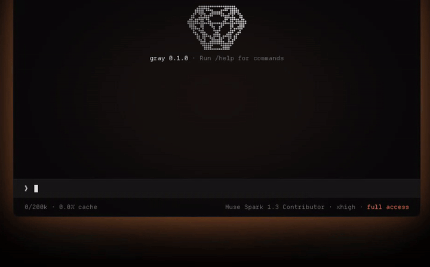

<div align="center">
  
  <h1>gray</h1>
  <p>A terminal coding agent. One Rust binary, your choice of model.</p>
  <p></p>
  <p><a href="https://gray.alignment.id">Website</a> · <a href="CHANGELOG.md">Changelog</a> · <a href="https://github.com/vstaln/gray/releases">Releases</a></p>
</div>

## Get started

**Linux and macOS**

```sh
curl -fsSL https://gray.alignment.id/install.sh | sh
gray
```

**Native Windows 10/11 x64** (Git for Windows supplies the shell). In PowerShell:

```powershell
irm https://gray.alignment.id/install.ps1 | iex
```

For an offline install, keep `dist/install.ps1` and the zip together and run `.\dist\install.ps1 -ArchivePath .\gray-stable-x86_64-windows.zip -Sha256 <digest>`. Beta and WSL installs are covered in the [Windows guide](docs/windows.md).

To build from source, run `cargo build --release -p gray` in this repo.

In Gray, type `/models` to pick a provider and model. Use Claude, an OpenAI-compatible endpoint, or a local model through Ollama.

## Everyday commands

| Command | What it does |
| --- | --- |
| `/models` | Switch provider, model, or effort. |
| `/sessions` | Reopen a saved conversation. |
| `gray -c` | Continue the most recent session in this directory. |
| `gray -p "summarize this repo"` | Run one prompt and exit. Add `--json` for JSONL. |
| `gray plugin` | Manage plugins for skills, memory, and scheduled jobs. |

Type `/` at the start of a new input to see available commands. Tab inserts the selected completion. To mention a slash command as text, put it in backticks.

[Plugins](docs/plugins.md) · [Themes and keybindings](docs/customization.md) · [Security](SECURITY.md)

**Safety:** Gray runs model-generated shell commands with your user privileges and no built-in sandbox. Use a container or VM for untrusted work.

[MIT license](LICENSE) · [Third-party notices](THIRD_PARTY_NOTICES.md)

*This project is generated with significant AI assistance.*
